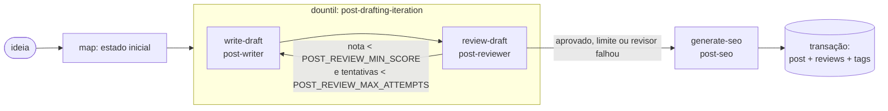

# Agentes de IA

Os agentes ficam em [src/mastra/agents/](../src/mastra/agents/) e são registrados na instância Mastra em [src/mastra/index.ts](../src/mastra/index.ts). Os services chamam todos com o mesmo padrão:

```ts
const { object } = await mastra.getAgent(AGENT_ID).generate(prompt, {
  structuredOutput: { schema }, // schema zod: a resposta do modelo já vem validada e tipada
  abortSignal: AbortSignal.timeout(env().ALGUM_TIMEOUT_MS)
})
```

Cada agente lê o próprio modelo de `<AGENTE>_MODEL`, no formato `provedor/modelo` do Mastra (padrão `google/gemini-2.5-flash`). Dá para usar um modelo barato para moderar e outro mais forte para escrever.

A regra comum a todos: **uma falha da IA nunca aprova, publica ou bloqueia nada sozinha**. O que acontece em cada caso está nas seções abaixo.

## Workflow `post-drafting`: `post-writer` → `post-reviewer` → `post-seo`

Chamado por `POST /posts/draft`. Ele fica em [src/mastra/workflows/post-drafting.ts](../src/mastra/workflows/post-drafting.ts):



1. O `post-writer` escreve o título e o conteúdo em Markdown a partir da ideia.
2. O `post-reviewer` dá uma nota de 0 a 10 e lista `issues` e `suggestions`.
3. Abaixo de `POST_REVIEW_MIN_SCORE` (padrão `7`), o redator reescreve com esse feedback e o revisor avalia de novo, até `POST_REVIEW_MAX_ATTEMPTS` versões (padrão `3`). O loop é um `dountil` sobre um workflow aninhado (`write → review`).
4. O `post-seo` gera, para a versão final, `summary` (até 300 caracteres), `meta_description` (até 160), uma sugestão de `slug` e até 5 tags. O prompt leva as tags já cadastradas, para o agente reaproveitá-las em vez de criar sinônimos.

O post, todas as revisões e as tags sugeridas são gravados juntos numa transação. O slug da IA passa pelo mesmo `slugify` e pela mesma checagem de colisão que o título passaria. A resposta traz a última revisão em `data.review`, e o histórico completo fica em `GET /posts/:id/review`. O workflow não guarda snapshots (`shouldPersistSnapshot: () => false`), porque roda de forma síncrona e não tem suspend/resume.

| Falha                                          | Resultado                                                                                  |
| ---------------------------------------------- | ------------------------------------------------------------------------------------------ |
| Redator                                        | Nada é gravado e a rota responde `502`                                                     |
| Revisor (ou estourou `POST_REVIEW_TIMEOUT_MS`) | O loop termina e o último rascunho é salvo sem essa revisão (`review` pode ser `null`)     |
| SEO (ou estourou `POST_SEO_TIMEOUT_MS`)        | O rascunho é salvo com o slug do título, sem tags e com `summary`/`meta_description` nulos |

Depois, o admin pode ajustar as tags com `PUT /posts/:id/tags` e os metadados com `PUT /posts/:id`. Como pode haver vários ciclos de LLM, a requisição demora mais que uma geração simples.

## `comment-moderator`

Chamado em `POST /posts/:id/comments`, antes de gravar. Ele avalia o comentário junto com o título e o começo do post e devolve um veredito, uma justificativa e categorias (`spam`, `toxic`, `off-topic`, `harassment`, `self-promotion`, `other`):

| Veredito  | `status`   | Mensagem do `201`             |
| --------- | ---------- | ----------------------------- |
| `approve` | `approved` | `Comment published`           |
| `reject`  | `rejected` | `Comment rejected`            |
| `review`  | `pending`  | `Comment awaiting moderation` |

A justificativa vai para `moderation_reason` e as categorias para `moderation_categories`. Se o modelo falhar, devolver algo fora do schema ou passar de `COMMENT_MODERATION_TIMEOUT_MS` (padrão 10 s), o comentário fica `pending` e entra na fila de `GET /comments` para um humano decidir. Aprovar manualmente limpa os dois campos.

## `comment-replier`

Chamado em `POST /comments/:id/reply` (admin). O agente propõe uma resposta para a pergunta do leitor com base **apenas no conteúdo do post**. Quando o comentário não é uma pergunta ou o post não a responde, a rota devolve `422` com o `reason` do agente.

- A resposta é gravada como comentário filho (`parent_id`), com `author_type: "ai"`, autor `Autor do blog (IA)` e status `pending`. Ela não passa pelo moderador e só fica pública depois de aprovada em `PATCH /comments/:id/approve`.
- Só comentários de leitores, de primeiro nível e aprovados podem ser respondidos, e cada um recebe no máximo um rascunho da IA (`409` caso contrário). Para gerar de novo, apague o rascunho com `DELETE /comments/:id`.
- Se o agente falhar ou passar de `COMMENT_REPLY_TIMEOUT_MS` (padrão 20 s), nada é gravado e a rota responde `502`.

## `editorial-planner` (agente com tools)

Chamado em `POST /editorial/ideas` (admin). É o único agente com **tools** ([src/mastra/tools/editorial.ts](../src/mastra/tools/editorial.ts), criadas com `createTool`). Em vez de receber tudo no prompt, ele consulta o blog sozinho:

| Tool              | O que devolve                                                                                             |
| ----------------- | --------------------------------------------------------------------------------------------------------- |
| `getPopularPosts` | Posts com mais curtidas na janela de `days` dias, com as contagens de curtidas e de comentários aprovados |
| `listTags`        | As tags em uso e quantos posts cada uma tem                                                               |
| `searchPosts`     | Busca full-text, usada para não repetir temas já publicados                                               |

O body é opcional: `count` (1 a 10, padrão `5`), `days` (1 a 365, padrão `30`) e `focus` (tema desejado, até 200 caracteres). Cada pauta traz `title`, `idea`, `rationale`, `suggested_tags` e `inspired_by`.

- O campo `idea` pode ir direto para `POST /posts/draft`, e o rascunho passa pelo revisor como qualquer outro. Isso fecha o ciclo: curtidas → pauta → rascunho → revisão → publicação.
- **Defesa contra alucinação:** em `inspired_by` ficam só os slugs que as tools de fato devolveram. Os inventados pelo modelo são descartados.
- Se o agente falhar ou passar de `EDITORIAL_IDEAS_TIMEOUT_MS` (padrão 60 s, já contando as chamadas de tools), a rota responde `502`.

## Testes

Nenhum teste chama um LLM de verdade. Os unitários ([test/unit/mastra/](../test/unit/mastra/) e [test/unit/services/](../test/unit/services/)) mockam os agentes. Os E2E mockam só `mastra.getAgent`, a fronteira com o serviço externo, e exercitam a cadeia real rota → service → workflow → Postgres.
